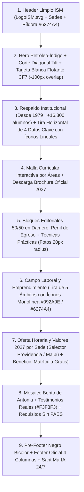

# Manual de Marca Digital — Instituto Santa María (Diseño Original de Antonia + Estándar Landings 2027)

> [!IMPORTANT]
> **Fuente de verdad extraída directamente del código en producción de `ismchile.cl`** (`Elementor Kit 12834`, hoja global `Vault / UiCore` y plantillas maestras de *Home*, *Quiénes somos*, *Cursos* y *Footer*). Este manual rige las **6 Landing Pages nativas de Admisión 2027** para que mantengan el 100% de la identidad visual de Antonia sin depender de Elementor.

---

## 1. Identidad Verbal, Logos y Activos Oficiales

| Activo | URL Oficial en Producción (`ismchile.cl`) | Regla de Uso |
| :--- | :--- | :--- |
| **Logo Blanco Vectorial (Principal Web)** | `https://www.ismchile.cl/wp-content/uploads/2023/09/LogoISM.svg` | Uso obligatorio sobre **Hero oscuro (Petróleo/Índigo)** y sobre **Footer negro (`#000000`)**. Proporción `viewBox="0 0 250.33 87.54"`, altura recomendada `46px–56px` en barra superior. |
| **Logo Institucional Bicolor** | `https://www.ismchile.cl/wp-content/uploads/2026/11/logo-institucional.png` | Uso exclusivo sobre barras o documentos de **fondo blanco (`#FFFFFF`)** o hielo (`#F8FAFE`). |
| ** Textura / Atmósfera Hero Desktop** | `https://www.ismchile.cl/wp-content/uploads/2025/11/6-1.jpg` | Imagen mesh degradada petróleo-a-índigo usada por Antonia en cabeceras principales, respaldada por gradiente CSS `linear-gradient(135deg, #0E4B63 0%, #163B5C 48%, #182558 100%)`. |
| **Atmósfera Hero Mobile** | `https://www.ismchile.cl/wp-content/uploads/2023/09/Fondo-Mobile2-1.jpg` | Variante vertical optimizada para pantallas `<= 767px`. |

---

## 2. Paleta de Colores Oficial (`Elementor Kit 12834`)

Antonia construyó una paleta institucional **serena, limpia y de alto contraste**, evitando rojos agresivos o tonos tierra ajenos al rubro educativo-técnico:

### Colores de Marca y Acción
| Token Semántico | Nombre ISM | Código HEX / RGB | Variable Original | Uso Exacto en el Diseño de Antonia |
| :--- | :--- | :--- | :--- | :--- |
| **Primario / Acento** | **Azul Pizarra Periwinkle** | `#6274A4` · `rgb(98, 116, 164)` | `--e-global-color-uicore_primary` | Botones píldora rellenos (`Habla con Nosotros`, `Enviar`), palabras destacadas en titulares sobre fondo negro, enlaces del footer, comillas de testimonios y check circular de tarjetas flotantes. |
| **Secundario / Hover** | **Azul Real Profundo** | `#092A9E` · `rgb(9, 42, 158)` | `--e-global-color-uicore_secondary` | Estado `:hover` y `:focus` de todos los botones primarios, subtítulos de énfasis y `theme-color` del navegador móvil. |
| **Índigo de Apoyo** | **Índigo Medio** | `#4054B2` / `#546ED3` | `--e-global-color-1b1937cb` | Color base de respaldo en bloques Hero y acentos secundarios. |
| **Atmósfera Hero** | **Petróleo a Azul Noche** | `#0E4B63` → `#182558` | `6-1.jpg` + Overlay | Fondo envolvente de apertura que da contraste limpio al logo blanco y al formulario flotante. |
| **Acción WhatsApp** | **Verde Conversación** | `#23A455` · `rgb(35, 164, 85)` | `--e-global-color-2decae0b` | Botón flotante e indicadores directos de atención por WhatsApp (`+56 9 5200 6799`). |

### Superficies Neutras y Textos
| Rol | Código HEX | Variable / Selector | Aplicación |
| :--- | :--- | :--- | :--- |
| **Lienzo Principal** | `#FFFFFF` | `--e-global-color-uicore_white` | Fondo principal de página, tarjetas de cursos, tarjeta flotante de formulario y corte diagonal `tilt`. |
| **Superficie Hielo** | `#F8FAFE` | `--e-global-color-uicore_light` | Contenedores suaves de beneficios, tablas de horarios/aranceles y fondos de inputs. |
| **Superficie Testimonios** | `#F3F3F3` | `.elementor-element-8eb80cb` | Banda dedicada al carrusel de testimonios de alumnos y egresados. |
| **Negro Editorial (Cierre)** | `#000000` | `elementor-13798` / Pre-Footer | Fondo de ancho completo del Pre-Footer y Footer institucional, y color de titulares `H1`–`H3` sobre fondo claro. |
| **Texto de Párrafo** | `#262626` | `--e-global-color-uicore_body` | Cuerpo de texto corrido, listas de requisitos y descripciones de malla curricular. |
| **Bordes y Divisores** | `#E6E9EC` / `#A3AFB7` / `#7C7C7C` | Inputs y Footer | `#E6E9EC` borde de input en reposo, `#A3AFB7` en hover, `#7C7C7C` línea divisoria en el bloque negro del Footer. |

### Acentos Pasteles para Iconografía Lineal y Áreas
- **Verde Salvia (`#9AC3BF`)**: Ícono lineal *Trayectoria* (desde 1979).
- **Rosa Arcilla (`#CC8B8E`)**: Ícono lineal *Excelencia* y barra cromática del área **Gastronomía / Pastelería**.
- **Celeste Cielo (`#6CBCCC`)**: Ícono lineal *Variadas Alternativas* (horarios diurnos, vespertinos y sábados).

> [!TIP]
> **La Regla del Titular Bicolor (Sello de Antonia):** En bloques oscuros de cierre (`#000000`), nunca se usa texto con gradiente; la primera mitad de la oración va en `#FFFFFF` y el remate va dentro de un `<span>` en `#6274A4`:
> `Comprometidos con tu esfuerzo, <span style="color: #6274a4;">somos tu mejor alternativa.</span>`


---

## 3. Sistema Tipográfico Oficial

A diferencia de otras escuelas gastronómicas que mezclan serifas francesas o cursivas, **el diseño de Antonia utiliza una sola familia tipográfica geométrica-humanista en todo el sitio**: **`Work Sans`** (alojada localmente en `/wp-content/uploads/elementor/google-fonts/fonts/worksans-*.woff2`).

| Nivel | Familia | Peso (`font-weight`) | Tamaño Desktop | Tamaño Mobile | Interlineado / Tracking | Uso |
| :--- | :--- | :--- | :--- | :--- | :--- | :--- |
| **H1 Hero Curso / Landing** | `Work Sans` | `600` (SemiBold) / `500` (Medium) | `48px` – `64px` | `34px` – `42px` | `1.12` · `-0.027em` | Nombre principal de la carrera en el Hero sobre fondo petróleo/índigo. |
| **H2 Título de Sección** | `Work Sans` | `600` (SemiBold) | `42px` – `48px` | `30px` – `34px` | `1.15` · `-0.027em` | Títulos principales de bloque (*Malla Curricular*, *Perfil de Egreso*, *Testimonios*, *Pre-Footer*). |
| **H3 Tarjeta / Sede** | `Work Sans` | `500` – `600` | `22px` – `26px` | `20px` – `22px` | `1.25` · `-0.027em` (`-1.3px`) | Títulos de tarjetas de cursos, encabezado del formulario flotante y nombres de sedes. |
| **H4 Subtítulo / Pilar** | `Work Sans` | `600` | `18px` – `20px` | `17px` – `18px` | `1.25` · `-0.02em` | Títulos de pilares (*Trayectoria*, *Excelencia*), tarjetas flotantes y unidades de malla. |
| **Cuerpo (`p`)** | `Work Sans` | `400` (Regular) | `17px` (`16px` listas) | `16px` | `1.60` · `0em` | Párrafos explicativos, descripciones de módulos y requisitos (máximo `65–72ch`). |
| **Botones y Controles** | `Work Sans` | `600` (SemiBold) | `15px` – `16px` | `15px` | `1.10` · `0em` | **Sentence case** (*Solicitar información*, *Habla con Nosotros*) — sin gritar todo en mayúsculas. |

---

## 4. Dirección de Arte y Uso de Imágenes (El Sello de Antonia)

El tratamiento fotográfico y espacial es el rasgo más reconocible del diseño original de `ismchile.cl`:

````carousel

<!-- slide -->

````

1. **Cero esquinas rectas en fotografías de contenido (`border-radius: 20px`)**:
   - Todas las imágenes de talleres, preparaciones y alumnos usan **`border-radius: 20px`** en escritorio (`18px` en tablet y **`15px` en móvil**) con `object-fit: cover`.
2. **El Mosaico Asimétrico ("Collage Bento ISM")**:
   - En lugar de poner una sola foto estática aislada, Antonia agrupa una **columna vertical (`3:4`)** junto a **dos fotos horizontales (`16:10`) + una tarjeta blanca flotante** (`border-radius: 20px`, `box-shadow: 0 25px 60px rgba(13, 32, 96, 0.08)`) con check circular `#6274A4` (*"Todos los cursos con Matrícula Gratis"*).
3. **El Corte Diagonal Blanco (`Tilt` SVG)**:
   - El Hero nunca corta en línea horizontal plana: lleva en su base el divisor diagonal blanco (`<svg viewBox="0 0 1000 100" preserveAspectRatio="none"><path fill="#ffffff" d="M0,6V0h1000v100L0,6z"/></svg>` invertido), permitiendo que el elemento derecho del Hero (el collage en Home o **la tarjeta blanca del formulario CF7 en nuestras Landings**) **cruce visualmente la diagonal** hacia la sección blanca inferior.
4. **Fotografía de "Manos en el Oficio"**:
   - Primeros planos reales, cálidos y bien iluminados de práctica real en talleres ISM (alisado de tortas, decoración con manga, masoterapia en camilla, corte y estilismo), complementados en galerías con recortes `4:3` (`960×720 px`).
5. **Iconografía Monolínea Fina**:
   - Íconos SVG de trazo continuo (`1.5px–1.75px`), nunca emojis ni íconos rellenos pesados.

---

## 5. Fusión Estratégica: Arquitectura *Escuela Culinaria* × Marca *Antonia ISM*

Para las **6 Landing Pages de Admisión 2027**, adoptamos la **secuencia exacta de conversión** que te gustó de `escuelaculinaria.cl/mencion-pasteleria/`, pero vestida al 100% con los tokens, fuentes, radios y colores de Antonia:



| Elemento de Conversión (Ref. *Escuela Culinaria*) | Adaptación al Manual de Marca ISM (*Antonia*) |
| :--- | :--- |
| Hero con foto + **Formulario blanco superpuesto (`-120px`)** visible en el primer pantallazo móvil | Atmósfera petróleo-índigo ISM + corte diagonal `tilt` + tarjeta blanca `border-radius: 20px` con `[contact-form-7]` real y botón píldora `100%` ancho en `#6274A4` → hover `#092A9E`. |
| Barra de **4 datos clave con íconos lineales** (*Inicio, Duración, Modalidad, Jornada*) | Íconos monolínea finos en `#6274A4` y valores destacados en `#092A9E` / `#000000` en `Work Sans`. |
| Bloques alternados 50/50 **Perfil de Egreso** y **Funciones** (ritmo damero) | Fotografías reales de talleres ISM con `border-radius: 20px` alternadas con bloques limpios en `Work Sans` sin saturar de tarjetas repetidas. |
| Tira de 5 bloques de **Campo Laboral** | Grilla limpia de 5 salidas laborales y emprendimiento con iconografía lineal uniforme. |
| **Vías de Admisión / Becas** + **Requisitos sin PAES** | Selector interactivo de **Sede Providencia (Alarife Gamboa 071)** y **Sede Maipú (General Ordóñez 253)** con todos los horarios y valores reales 2027 + checklist **Sin PAES** + CTA directo a WhatsApp. |
| Cierre institucional | **Pre-Footer y Footer negro (`#000000`) exacto de Antonia** con titular bicolor blanco + `#6274A4`. |
