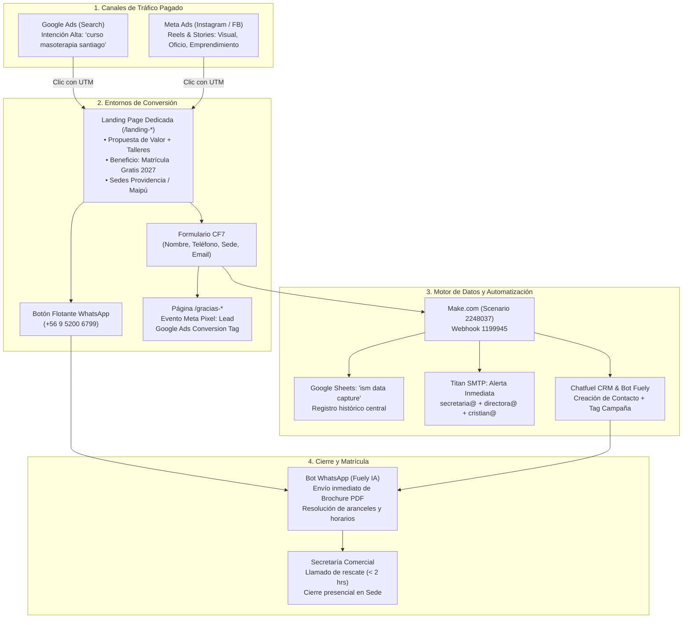

# Plan Maestro de Generación de Demanda — Admisión 2027
## Instituto Santa María (ISM) | Providencia & Maipú

Este documento define la arquitectura integral de adquisición, conversión, nutrición y cierre de matrículas para el ciclo **Admisión 2027**, integrando todos los activos y herramientas técnicas ya configuradas.

---

## 1. Mapa de la Arquitectura del Sistema (Full Funnel)

---

## 2. Estrategia de Medios (Meta Ads vs. Google Ads)

### A. Google Ads (Captura de Demanda Existente — Alta Intención)
* **Objetivo:** Captar a la persona que **ya tomó la decisión** de capacitarse y está buscando activamente dónde estudiar.
* **Red:** Búsqueda (Search) con concordancia de frase y exacta.
* **Campañas segmentadas por Curso:**
  1. *Cursos Estética y Cosmetología* ➔ Destino: `/landing-cosmetologia-esteticaintegral/`
  2. *Curso Masoterapia* ➔ Destino: `/landing-masoterapia-masofilaxia/`
  3. *Curso Pastelería y Repostería* ➔ Destino: `/landing-pasteleria/`
  4. *Curso Peluquería y Estilista* ➔ Destino: `/landing-estilista-peluqueria/`
  5. *Cursos Salud / Enfermería* ➔ Destino: `/landing-enfermeria/`
  6. *Curso Maquillaje* ➔ Destino: `/landing-maquillaje-integral/`
* **Keywords Clave:** `curso pasteleria santiago`, `curso masoterapia maipu`, `estudiar cosmetologia providencia`, `cursos tecnicos santiago`.
* **Anuncios:**
  * Título 1: *Curso de [Curso] 2027 | Matrícula Gratis*
  * Título 2: *Sedes a Pasos de Metro Providencia y Maipú*
  * Descripción: *Aprende en talleres 100% prácticos. Instituto fundado en 1979. ¡Asegura tu cupo con Matrícula Costo Cero!*

---

### B. Meta Ads (Generación de Demanda — Inspiración & Emprendimiento)
* **Objetivo:** Despertar el deseo en personas que buscan independencia económica, emprender un negocio propio o aprender un oficio rentable.
* **Formatos Ganadores:**
  * **Reels / Stories (9:16):** Videos cortos de alumnas en talleres reales (decorando tortas, aplicando masajes con piedras calientes, clases de maquillaje). El gancho inicial: *"¿Quieres emprender en estética este 2027? Mira cómo aprenden nuestras alumnas desde el primer día."*
  * **Carrusel de Fotos:** Foto 1: Taller práctico; Foto 2: Malla curricular resumida; Foto 3: Beneficio Matrícula Gratis 2027; Foto 4: Ubicación de las dos sedes.
* **Segmentación:**
  * **Ubicación:** Región Metropolitana (Radio 15 km alrededor de Providencia y 15 km alrededor de Plaza de Maipú).
  * **Edad:** 20 a 55 años.
  * **Intereses:** Emprendimiento, Belleza, Gastronomía, Cuidado personal, Bienestar.

---

## 3. Arquitectura CRO de las Landings (`/landing-*`)

Las 6 landings cumplen con los principios de optimización de conversión:

1. **Sin menú superior de distracción:** El usuario no se fuga a leer noticias o "quiénes somos"; su atención se concentra en la oferta.
2. **Doble llamada a la acción (Dual CTA):**
   * **Opción A (Formulario CF7):** Para el usuario que prefiere que lo contacten con el arancel formal.
   * **Opción B (Botón WhatsApp):** Para el usuario impulsivo que quiere chatear de inmediato.
3. **Mapeo de UTMs en enlaces:**
   * En Meta Ads:
     `https://www.ismchile.cl/landing-pasteleria/?utm_source=instagram&utm_medium=reel&utm_campaign=admision2027`
   * En Google Ads:
     `https://www.ismchile.cl/landing-pasteleria/?utm_source=google&utm_medium=cpc&utm_campaign=search_pasteleria`
4. **Página de Confirmación (`/gracias-*`):**
   * Dispara el evento `Lead` en Meta Pixel y Google Tag Manager.
   * Entrega un refuerzo positivo: *"¡Tu solicitud fue recibida! Un asesor te contactará o puedes escribirnos ya al WhatsApp."*

---

## 4. El Motor de Automatización en Tiempo Real (Make + Chatfuel)

La clave para que la pauta no se pierda es la **velocidad de respuesta (Lead Response Time < 2 minutos)**:

* **Paso 1 (Captura):** El prospecto completa el formulario en la landing.
* **Paso 2 (Make.com):** El Webhook `1199945` recibe la información al instante.
  * Inserta fila en Google Sheets (`ism data capture`).
  * Envía correo con formato ejecutivo a `secretaria@ismchile.cl`, `directora@ismchile.cl` y `cristian@ismchile.cl`.
  * Envía mutación GraphQL a Chatfuel (`whatsappContactCreateV2`) creando el contacto y asignándole la etiqueta del curso.
* **Paso 3 (Bot Fuely en WhatsApp):** El bot saluda al alumno en su propio WhatsApp, le adjunta el brochure oficial 2027 en PDF y se pone a su disposición para resolver aranceles, sedes y horarios.

---

## 5. Protocolo de Venta y Cierre en Sedes

| Etapa | Responsable | Canal | Acción |
| :--- | :--- | :--- | :--- |
| **0 - 5 min** | Chatfuel / Fuely IA | WhatsApp | Mensaje de bienvenida, entrega de malla curricular en PDF y confirmación del beneficio **Matrícula Gratis 2027**. |
| **5 min - 2 hrs** | Chatfuel / Fuely IA | WhatsApp | Responder dudas frecuentes (duración, horarios diurnos/vespertinos/sábados, facilidades de pago en cuotas). |
| **2 hrs - 24 hrs** | Secretaría Providencia / Maipú | Llamado Telefónico | Llamar a los leads que no continuaron el flujo en WhatsApp: *"Hola [Nombre], vimos tu interés en Pastelería para sede Maipú. ¿Te gustaría venir a conocer los talleres este sábado?"* |
| **Cierre** | Secretaría en Sede | Presencial | Firma de contrato de matrícula y entrega de bienvenida. |

---

## 6. Métricas y KPIs de Control Diario

* **CPL (Costo por Lead):** Meta: entre \$1.800 y \$4.500 CLP por prospecto calificado.
* **Tasa de Conversión Landing (CVR):** Entre 8% y 15% de los visitantes deben dejar sus datos o abrir WhatsApp.
* **Tasa de Contacto Efectivo:** > 80% de los leads deben ser abordados por WhatsApp o teléfono en menos de 2 horas.
* **Tasa de Cierre a Matrícula:** 1 de cada 10 a 15 leads debe convertirse en matrícula confirmada.
