# Flujo de Atención WhatsApp — Bot Principal (Enrutador)

> [!info] Actualización 17-oct-2026 — arquitectura sin Kommo
> Este bot **ya no corre en Kommo (Salesbot)**. Se reconstruye como un **único flujo maestro en Chatfuel** que da la bienvenida, captura `{{sede}}` y `{{curso}}`, y deriva al cierre humano vía **Make.com → Google Sheets + aviso a la asesora**. Se eliminan los sub-bots con ID de Kommo y las acciones de pipeline/etapa.

Este documento describe la arquitectura y lógica del chatbot principal de **Atención WhatsApp**, encargado de dar la bienvenida, capturar la sede y la carrera del contacto y derivar automáticamente al cierre humano.

---

## Diagrama de Flujo (Mermaid)

```mermaid
flowchart TD
    %% Estilos
    classDef startNode fill:#1e293b,stroke:#38bdf8,stroke-width:2px,color:#fff;
    classDef questionNode fill:#0f172a,stroke:#818cf8,stroke-width:2px,color:#fff;
    classDef actionNode fill:#14532d,stroke:#4ade80,stroke-width:1px,color:#fff;
    classDef flowNode fill:#312e81,stroke:#a78bfa,stroke-width:2px,color:#fff;
    classDef humanNode fill:#7c2d12,stroke:#fb923c,stroke-width:1px,color:#fff;

    Start(["▶ INICIO (Lead escribe por WhatsApp)"]):::startNode --> Step0

    %% MENÚ PRINCIPAL
    Step0["<b>Paso 0: Bienvenida ISM</b><br/>¿Cómo te ayudamos hoy?"]:::questionNode

    Step0 -->|"Información Cursos"| Step2["<b>Paso 2: Selección de Sede</b><br/>¿Cuál sede te acomoda?"]:::questionNode
    Step0 -->|"Otra Consulta"| Step32["<b>Paso 32: Mensaje libre</b><br/>'Escríbenos tu duda...'"]:::humanNode
    Step0 -->|"Espero que me llamen"| Step37["<b>Paso 37-39: Gestión de Llamada</b><br/>Informa horarios de secretaría"]:::questionNode
    Step0 -->|"Texto libre / Timeout (300s)"| Step41["<b>Paso 41: Advertencia</b><br/>'Por favor usa los botones'"]:::questionNode
    Step41 --> Step0

    %% ATENCIÓN MANUAL Y LLAMADAS
    Step32 --> Step33["<b>Acción: Webhook a Make</b><br/>Registra lead + avisa asesora + pausa bot"]:::actionNode
    Step37 --> Step39{"¿Prefieres WhatsApp<br/>o llamada?"}:::questionNode
    Step39 -->|"Prefiero WhatsApp"| Step0
    Step39 -->|"Espero que me llamen"| Step40["<b>Paso 40: Confirmación</b><br/>Te contactaremos pronto"]:::humanNode

    %% RAMA DE SEDES
    Step2 -->|"Sede Maipú"| TagMaipu["<b>Paso 34: Acción</b><br/>Guarda atributo {{sede}} = 'Maipú'"]:::actionNode
    Step2 -->|"Sede Providencia"| TagProvi["<b>Paso 35: Acción</b><br/>Guarda atributo {{sede}} = 'Providencia'"]:::actionNode

    %% CATÁLOGO MAIPÚ
    TagMaipu --> Step1["<b>Paso 1: Catálogo Maipú</b><br/>¿Qué carrera te interesa?"]:::questionNode
    Step1 -->|"Estilista Unisex"| BotMa_1["📄 Ficha Estilista Maipú<br/><i>({{curso}} = Estilista)</i>"]:::flowNode
    Step1 -->|"Peluquería Unisex"| BotMa_2["📄 Ficha Peluquería Maipú<br/><i>({{curso}} = Peluquería)</i>"]:::flowNode
    Step1 -->|"Maquillaje Integral"| BotMa_3["📄 Ficha Maquillaje Maipú<br/><i>({{curso}} = Maquillaje)</i>"]:::flowNode
    Step1 -->|"Estética Integral"| BotMa_4["📄 Ficha Estética Maipú<br/><i>({{curso}} = Estética)</i>"]:::flowNode
    Step1 -->|"Cosmetología"| BotMa_5["📄 Ficha Cosmetología Maipú<br/><i>({{curso}} = Cosmetología)</i>"]:::flowNode
    Step1 -->|"Masoterapia I."| BotMa_6["📄 Ficha Masoterapia Maipú<br/><i>({{curso}} = Masoterapia)</i>"]:::flowNode
    Step1 -->|"Pastelería y Rep."| BotMa_7["📄 Ficha Pastelería Maipú<br/><i>({{curso}} = Pastelería)</i>"]:::flowNode
    Step1 -->|"Otro"| Step32

    %% CATÁLOGO PROVIDENCIA
    TagProvi --> Step17["<b>Paso 17: Catálogo Providencia</b><br/>¿Qué carrera te interesa?"]:::questionNode
    Step17 -->|"Estilista Unisex"| BotPr_1["📄 Ficha Estilista Providencia<br/><i>({{curso}} = Estilista)</i>"]:::flowNode
    Step17 -->|"Peluquería Unisex"| BotPr_2["📄 Ficha Peluquería Providencia<br/><i>({{curso}} = Peluquería)</i>"]:::flowNode
    Step17 -->|"Maquillaje Integral"| BotPr_3["📄 Ficha Maquillaje Providencia<br/><i>({{curso}} = Maquillaje)</i>"]:::flowNode
    Step17 -->|"Estética Integral"| BotPr_4["📄 Ficha Estética Providencia<br/><i>({{curso}} = Estética)</i>"]:::flowNode
    Step17 -->|"Cosmetología"| BotPr_5["📄 Ficha Cosmetología Providencia<br/><i>({{curso}} = Cosmetología)</i>"]:::flowNode
    Step17 -->|"Masoterapia I."| BotPr_6["📄 Ficha Masoterapia Providencia<br/><i>({{curso}} = Masoterapia)</i>"]:::flowNode
    Step17 -->|"Pastelería y Rep."| BotPr_7["📄 Ficha Pastelería Providencia<br/><i>({{curso}} = Pastelería)</i>"]:::flowNode
    Step17 -->|"Otro"| Step32
```

---

## Catálogo de Fichas (sin sub-bots)

| Sede | Programa de Estudio | Atributo que guarda |
|---|---|---|
| **Maipú** | Estilista Unisex / Peluquería Unisex | `{{curso}}` = Estilista / Peluquería |
| **Maipú** | Maquillaje Integral | `{{curso}}` = Maquillaje |
| **Maipú** | Estética Integral / Cosmetología | `{{curso}}` = Estética / Cosmetología |
| **Maipú** | Masoterapia Integral | `{{curso}}` = Masoterapia |
| **Maipú** | Pastelería y Repostería | `{{curso}}` = Pastelería |
| **Providencia** | Estilista Unisex / Peluquería Unisex | `{{curso}}` = Estilista / Peluquería |
| **Providencia** | Maquillaje Integral | `{{curso}}` = Maquillaje |
| **Providencia** | Estética Integral / Cosmetología | `{{curso}}` = Estética / Cosmetología |
| **Providencia** | Masoterapia Integral | `{{curso}}` = Masoterapia |
| **Providencia** | Pastelería y Repostería | `{{curso}}` = Pastelería |

> Las fichas son **una sola por carrera** (no por sede): el contenido se arma con las variables `{{curso}}` y `{{sede}}` para evitar duplicación de flujos.

---

## Acciones de Salida (Make.com)

1. **Captura de variables (`set_attribute`):**
   * Al seleccionar Maipú: guarda `{{sede}}` = `Maipú`.
   * Al seleccionar Providencia: guarda `{{sede}}` = `Providencia`.
   * Al elegir carrera: guarda `{{curso}}`.
2. **Derivación a atención humana:**
   * En *«Otra Consulta»*, tras solicitar el mensaje libre, se dispara un **Webhook a Make** que: registra el lead en `Leads Admisión 2027`, avisa a la asesora según `{{sede}}`, agrega el contacto a Brevo y **pausa el bot**.
   * En caso de excepción técnica, el flujo reinicia la bienvenida (sin pipeline de Kommo).

---

## Ver también
- [[integrations_map]] — mapa de integraciones.
- [[Flujo-Unico-Integral-2027]] — flujo único maestro.
- [[05-Mapa-Flujos-Comunicacion]] — flujos por canal y sede.
