# Flujo de Atención WhatsApp — Bot Principal (Enrutador)

Este documento describe la arquitectura y lógica del chatbot principal de **Atención WhatsApp** en Kommo (Salesbot), encargado de dar la bienvenida, etiquetar la sede del contacto y derivar automáticamente a los sub-bots especializados por carrera.

---

## Diagrama de Flujo (Mermaid)

```mermaid
flowchart TD
    %% Estilos
    classDef startNode fill:#1e293b,stroke:#38bdf8,stroke-width:2px,color:#fff;
    classDef questionNode fill:#0f172a,stroke:#818cf8,stroke-width:2px,color:#fff;
    classDef actionNode fill:#14532d,stroke:#4ade80,stroke-width:1px,color:#fff;
    classDef subbotNode fill:#312e81,stroke:#a78bfa,stroke-width:2px,color:#fff;
    classDef humanNode fill:#7c2d12,stroke:#fb923c,stroke-width:1px,color:#fff;

    Start(["▶ INICIO (Lead escribe por WhatsApp)"]):::startNode --> Step0

    %% MENÚ PRINCIPAL
    Step0["<b>Paso 0: Bienvenida ISM</b><br/>¿Cómo te ayudamos hoy?"]:::questionNode

    Step0 -->|"Información Cursos"| Step2["<b>Paso 2: Selección de Sede</b><br/>¿Cuál sede te acomoda?"]:::questionNode
    Step0 -->|"Otra Consulta"| Step32["<b>Paso 32: Mensaje libre</b><br/>'Escríbenos tu duda...'"]:::humanNode
    Step0 -->|"Espero que me llamen"| Step37["<b>Paso 37-39: Gestión de Llamada</b><br/>Informa horarios de secretaría"]:::questionNode
    Step0 -->|"Texto libre / Timeout (300s)"| Step41["<b>Paso 41: Advertencia</b><br/>'Por favor usa los botones'"]:::questionNode
    Step41 --> Step0

    %% ATENCIÓN MANUAL Y LLAMADAS
    Step32 --> Step33["<b>Acción Kommo</b><br/>Mueve lead a etapa 'Consulta abierta' (88567243)"]:::actionNode
    Step37 --> Step39{"¿Prefieres WhatsApp<br/>o llamada?"}:::questionNode
    Step39 -->|"Prefiero WhatsApp"| Step0
    Step39 -->|"Espero que me llamen"| Step40["<b>Paso 40: Confirmación</b><br/>Te contactaremos pronto"]:::humanNode

    %% RAMA DE SEDES
    Step2 -->|"Sede Maipú"| TagMaipu["<b>Paso 34: Acción</b><br/>Asigna Etiqueta: 'Sede Maipú'"]:::actionNode
    Step2 -->|"Sede Providencia"| TagProvi["<b>Paso 35: Acción</b><br/>Asigna Etiqueta: 'Sede Providencia'"]:::actionNode

    %% CATÁLOGO MAIPÚ
    TagMaipu --> Step1["<b>Paso 1: Catálogo Maipú</b><br/>¿Qué carrera te interesa?"]:::questionNode
    Step1 -->|"Estilista Unisex"| Bot86298_1["🤖 Inicia Sub-Bot 86298<br/><i>(Estilista Maipú)</i>"]:::subbotNode
    Step1 -->|"Peluquería Unisex"| Bot86298_2["🤖 Inicia Sub-Bot 86298<br/><i>(Peluquería Maipú)</i>"]:::subbotNode
    Step1 -->|"Maquillaje Integral"| Bot86446["🤖 Inicia Sub-Bot 86446<br/><i>(Maquillaje Maipú)</i>"]:::subbotNode
    Step1 -->|"Estética Integral"| Bot86402_1["🤖 Inicia Sub-Bot 86402<br/><i>(Estética Maipú)</i>"]:::subbotNode
    Step1 -->|"Cosmetología"| Bot86402_2["🤖 Inicia Sub-Bot 86402<br/><i>(Cosmetología Maipú)</i>"]:::subbotNode
    Step1 -->|"Masoterapia I."| Bot86408["🤖 Inicia Sub-Bot 86408<br/><i>(Masoterapia Maipú)</i>"]:::subbotNode
    Step1 -->|"Pastelería y Rep."| Bot86694["🤖 Inicia Sub-Bot 86694<br/><i>(Pastelería Maipú)</i>"]:::subbotNode
    Step1 -->|"Otro"| Step32

    %% CATÁLOGO PROVIDENCIA
    TagProvi --> Step17["<b>Paso 17: Catálogo Providencia</b><br/>¿Qué carrera te interesa?"]:::questionNode
    Step17 -->|"Estilista Unisex"| Bot86374_1["🤖 Inicia Sub-Bot 86374<br/><i>(Estilista Provi)</i>"]:::subbotNode
    Step17 -->|"Peluquería Unisex"| Bot86374_2["🤖 Inicia Sub-Bot 86374<br/><i>(Peluquería Provi)</i>"]:::subbotNode
    Step17 -->|"Maquillaje Integral"| Bot86430["🤖 Inicia Sub-Bot 86430<br/><i>(Maquillaje Provi)</i>"]:::subbotNode
    Step17 -->|"Estética Integral"| Bot86404_1["🤖 Inicia Sub-Bot 86404<br/><i>(Estética Provi)</i>"]:::subbotNode
    Step17 -->|"Cosmetología"| Bot86404_2["🤖 Inicia Sub-Bot 86404<br/><i>(Cosmetología Provi)</i>"]:::subbotNode
    Step17 -->|"Masoterapia I."| Bot86420["🤖 Inicia Sub-Bot 86420<br/><i>(Masoterapia Provi)</i>"]:::subbotNode
    Step17 -->|"Pastelería y Rep."| Bot86448["🤖 Inicia Sub-Bot 86448<br/><i>(Pastelería Providencia)</i>"]:::subbotNode
    Step17 -->|"Otro"| Step32
```

---

## Tabla de Mapeo de Sub-Bots en Kommo

| Sede | Programa de Estudio | ID Bot Hijo en Kommo |
|---|---|:---:|
| **Maipú** | Estilista Unisex / Peluquería Unisex | `86298` |
| **Maipú** | Maquillaje Integral | `86446` |
| **Maipú** | Estética Integral / Cosmetología | `86402` |
| **Maipú** | Masoterapia Integral | `86408` |
| **Maipú** | Pastelería y Repostería | `86694` |
| **Providencia** | Estilista Unisex / Peluquería Unisex | `86374` |
| **Providencia** | Maquillaje Integral | `86430` |
| **Providencia** | Estética Integral / Cosmetología | `86404` |
| **Providencia** | Masoterapia Integral | `86420` |
| **Providencia** | Pastelería y Repostería | `86448` |

---

## Acciones de CRM Asociadas

1. **Etiquetado (`set_tag`):**
   * Al seleccionar Maipú: agrega etiqueta `Sede Maipú`.
   * Al seleccionar Providencia: agrega etiqueta `Sede Providencia`.
2. **Derivación a Atención Humana:**
   * En casos de opción *«Otra Consulta»*, tras solicitar el mensaje libre se cambia el estado del lead al ID de pipeline `88567243` (*Consulta abierta / En espera de respuesta*).
   * En caso de excepción técnica (`on_error` global), el lead pasa automáticamente al estado `88180143`.
