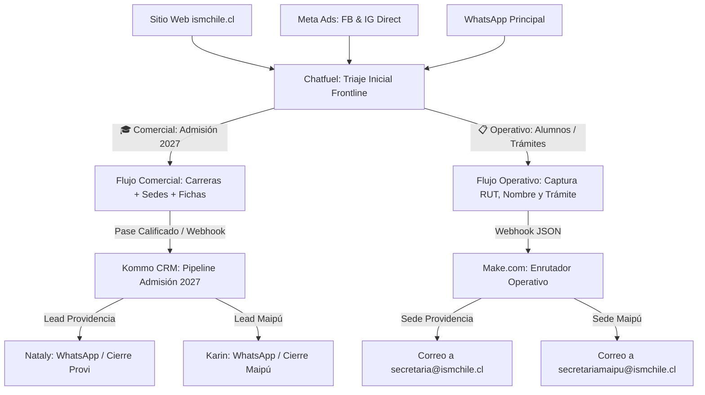

# Mapa de Integraciones (Marketing Tech Stack)

Este documento es para mapear cómo se conectan las herramientas entre sí.

## Entradas (Captación)
- **Sitio Web (ismchile.cl):** Tráfico orgánico y pago. 
- **Meta Business Suite:** Anuncios y contenido en IG/FB (Sedes Providencia y Maipú unificadas bajo Fran).
- **WhatsApp Business:** Consultas directas.
- **Chatfuel:** Chatbot en el sitio web y/o Facebook Messenger.

## Procesamiento y Automatización (Middleware)
- **Make:** Herramienta central para conectar flujos (Ej: Si entra un lead por WA, Make lo envía al CRM).

## Gestión y Nutrición (CRM)
- **Kommo:** Gestión de ventas y seguimiento de los leads captados.
- **Brevo:** Email marketing, newsletters y nutrición automatizada de los contactos en Kommo.

## Arquitectura de Flujo y Derivación (Octubre 2026)

## Reglas Operativas
1. **Ruta Operativa (Alumnos Actuales):** Se resuelve mediante notificación directa vía Make a las secretarías de cada sede. **No ingresa a Kommo**, optimizando las licencias de usuario y manteniendo el embudo comercial libre de trámites.
2. **Ruta Comercial (Admisión 2027):** El prospecto interactúa con menús estructurados (cero consumo de tokens en opciones predefinidas) y la IA solo interviene en preguntas libres. Los prospectos calificados se crean automáticamente en Kommo y se asignan a las ejecutivas según la sede seleccionada.

