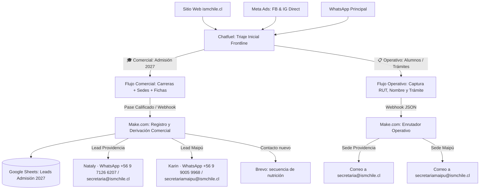

# Mapa de Integraciones (Marketing Tech Stack)

Este documento es para mapear cómo se conectan las herramientas entre sí.

> [!info] Actualización 17-oct-2026 — salida de Kommo
> Se **deja de usar Kommo** para el flujo de Admisión 2027. El CRM de pago se reemplaza por un **CRM ligero**: registro de prospectos en **Google Sheets** orquestado con **Make.com**, más avisos a las asesoras de sede y nutrición por **Brevo**.

## Entradas (Captación)
- **Sitio Web (ismchile.cl):** Tráfico orgánico y pago.
- **Meta Business Suite:** Anuncios y contenido en IG/FB (Sedes Providencia y Maipú unificadas bajo Fran).
- **WhatsApp Business:** Consultas directas.
- **Chatfuel:** Chatbot en el sitio web, Facebook/Instagram y WhatsApp (`+56 9 5200 6799`).

## Procesamiento y Automatización (Middleware)
- **Make:** Herramienta central para conectar flujos (Ej: si entra un lead por WA, Make lo registra en la hoja, avisa a la sede y lo agrega a Brevo).

## Gestión y Nutrición (sin CRM de pago)
- **Google Sheets — `Leads Admisión 2027`:** Base de prospectos y seguimiento comercial (reemplaza el pipeline de Kommo).
- **Brevo:** Email marketing, newsletters y nutrición automatizada de los contactos.

## Arquitectura de Flujo y Derivación (Octubre 2026)

## Reglas Operativas
1. **Ruta Operativa (Alumnos Actuales):** Se resuelve mediante notificación directa vía Make a las secretarías de cada sede. **No genera lead comercial**, manteniendo el registro de admisión libre de trámites.
2. **Ruta Comercial (Admisión 2027):** El prospecto interactúa con menús estructurados (cero consumo de tokens en opciones predefinidas) y la IA solo interviene en preguntas libres. Los prospectos calificados se registran automáticamente en la hoja `Leads Admisión 2027` y se avisa a la asesora según la sede seleccionada.
3. **Cierre humano:** Las asesoras cierran desde el WhatsApp de su sede; el bot anticipa el cambio de número en el mensaje de derivación.
